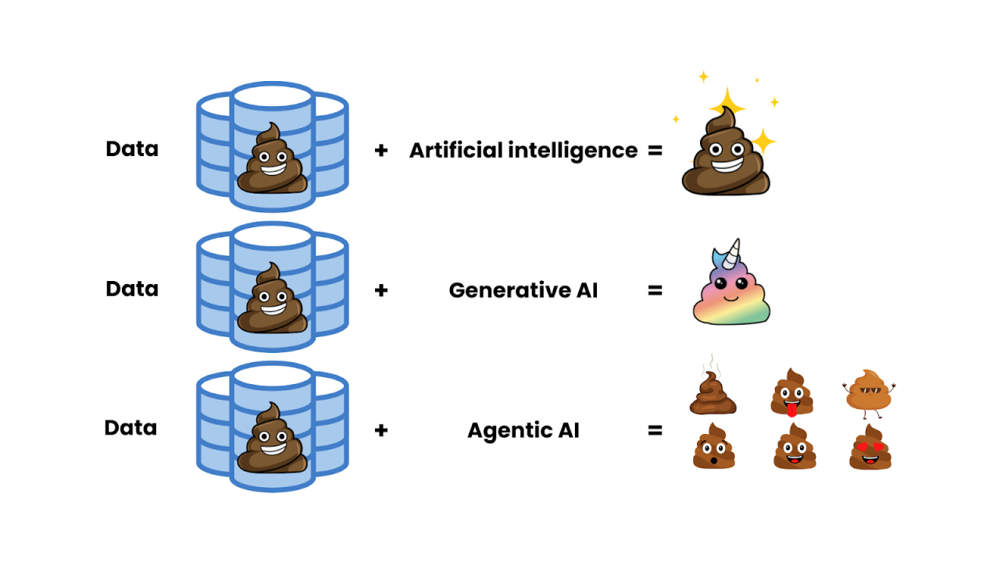
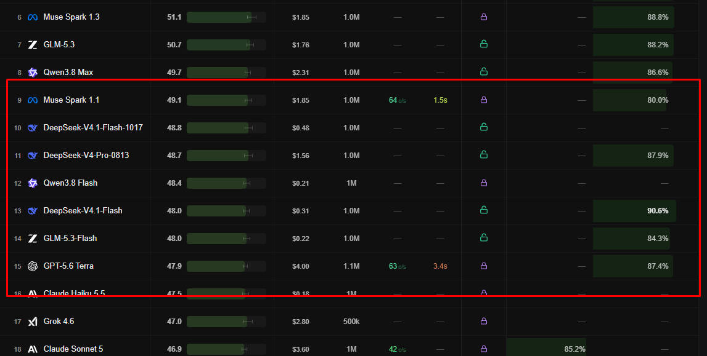
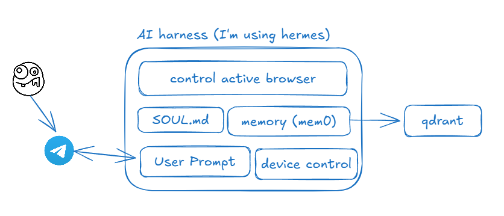
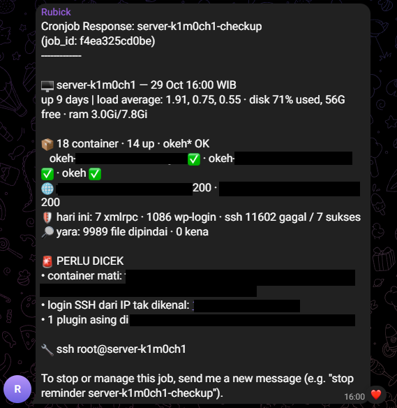
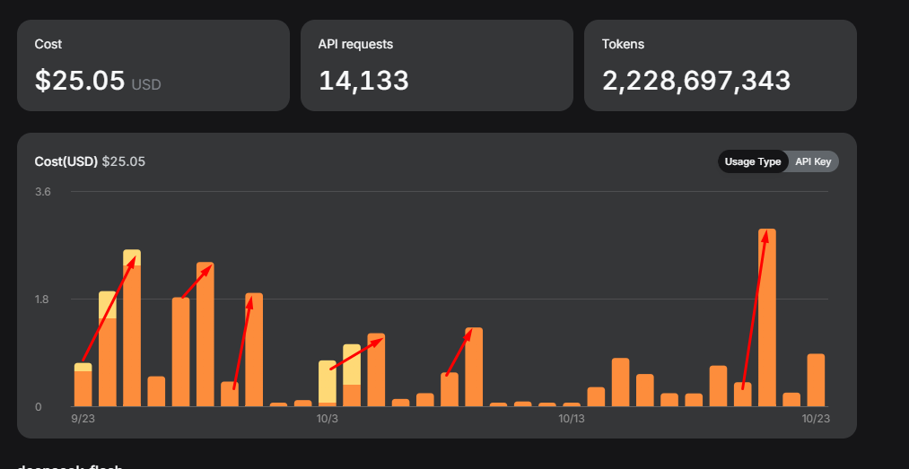

# THis post 100% human organic, no AI involvement.

my previous post talking about AI fatigue where you feel overwhelming by the new technology, yet you can't keep the pace, so you shitting yourself and cry over fancy shit.

no, I'm not talking about shit, I'm talking about how to overcome this AI fatigue, by maxed the AI utilization in order maybe keep the pace up at least over the trend, so AI will babysit you with baby language to keep up the "trend" pace.

---

why we need to keep up this shitty AI "trend" pace, lets face it we can't handle all the information with what happen on internet right ?, so lets set the goal "automate the repeated work with cheap AI"

the "work" as in the same daily task with same rule (deterministic), also why "cheap"?

I'm broke, thats it, I don't want waste my fucking money to glorifying with AI

so lets start making this shitty agentic AI

---

## The Plan

I'm going to the point, I will automate my deterministic task by creating the AI agentic with cheap AI.

and the AI I propose immediatelly with deepseek, I come to friend tweet on X and they said mocin is the way,

since december 2025 I already use the GLM z.ai, but I can't continue because the price is getting high, so I need to get the cheap one and reliable, I get to https://llm-stats.com/leaderboards/best-ai-for-reasoning and exactly not choose the number one becaues too fucking expensive and get into the middle one

this why I get into deepseek 

---

now my idea is to get control my device, logged in into my account, checking my email, check-in the work and could do that daily task.

and here is my arch propose 

and this mean I need a running device and this mean I revive my old laptop and running it as the AI agentic (not on VPS)

https://x.com/BukanYahya/status/2101524830831174089

and I install omarchy under the laptop.

https://x.com/BukanYahya/status/2102585997955592363

why omarchy ? simply I wanted to use arch linux, but trend said omarchy is kinda agentic OS, so I simply choose it like that 

since omarchy is agnostic, I don't mind

---

## The Execution ?

I made the group telegram with this three AI agent 

the `k1m0ch1` agent is actually my working PC, this mean when the PC is dead, it will also death, this used the command-code subscription with default model is glm-5-3 with fallback deepseek, this bot planned to control my device whenever I'm outside and I need access AI from my computer

the `Yttrium` agent is VPS machine, under my working claude account, claude account connected through 9router because hermes is dumb enough to login via claude subscription with fallback deepseek, for my daily work

the `Rubick` named after unborn my child, idk I love her so much, I hope you still alive, so here I use you as agent at old laptop, still use hermess agent on my old laptop login via deepseek api

this tooks me about 3 days to personalize the AI so they will understand my request.

and lastly I used the RustDesktop for Remote Desktop all Device

---

## The Result

FUck shit, I love it,

I believe this is just a basic AI utilization, the performance is better, I love hermess.

I automate my 3 other work that require just reporting and checking the server.

and for deepseek I become love deepseek so much 2 Billion token only for 20 dollar, WTF man 

I discontinued the claude subscription ahahaha, I only have command code, deepseek and working account now 

and yes, my fatigue is clear now, more relaxed

---

## THE Improvement

right right, I think I need improvement, because long running AI is way better than doing this shit 

I wanna makes a proper device setup

another device for agentic 

fallback with free account 

