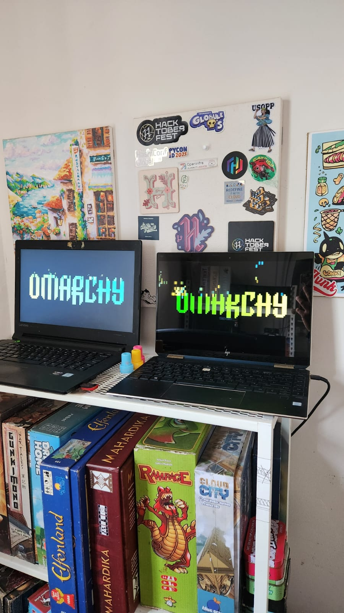
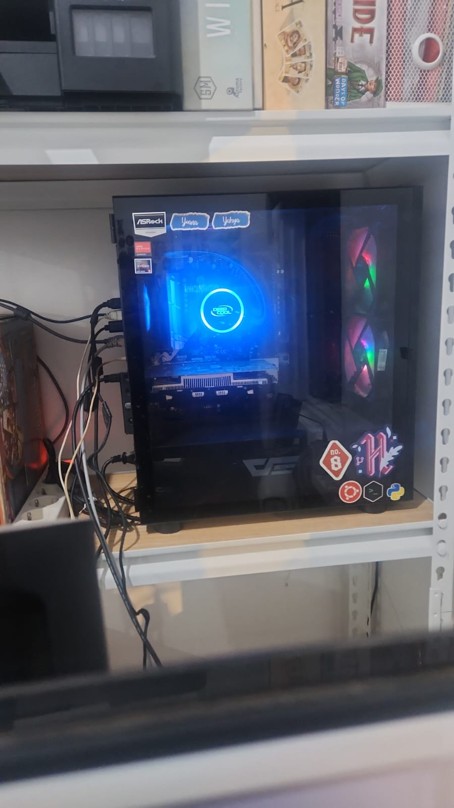
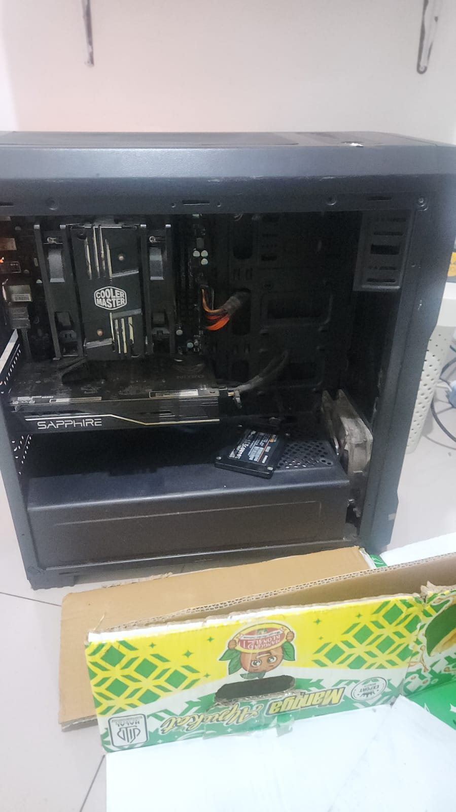
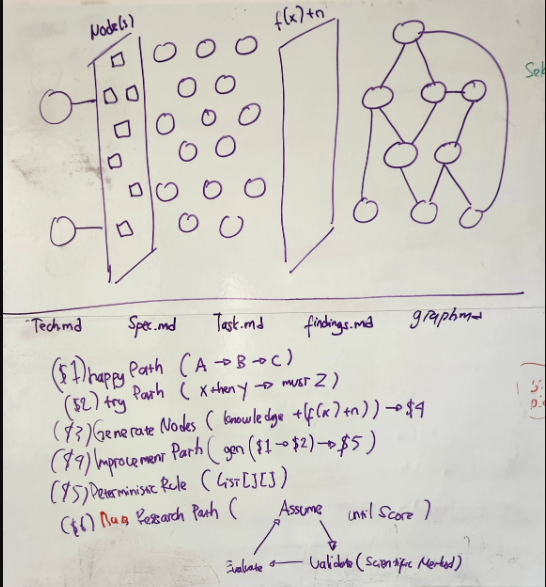
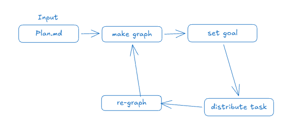
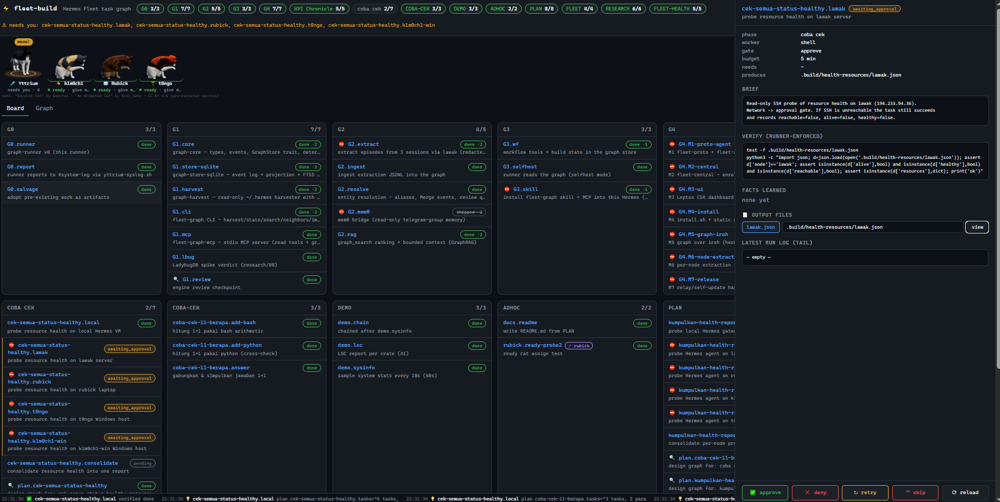
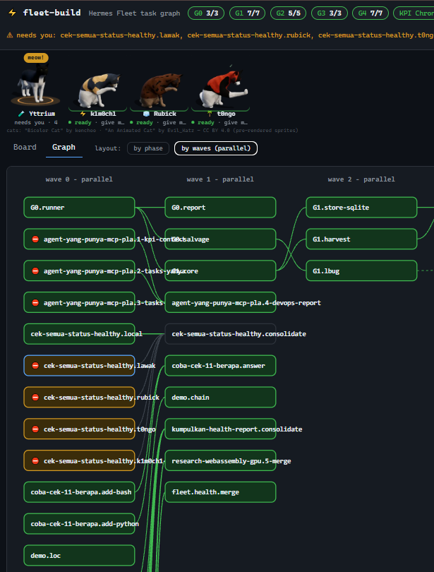
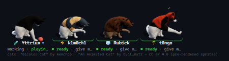

Hello Clankers, back again with me, good god we have a new problem boys

my PC and my Server is not enough to handle my workload, 

if you wondering what my workload is, mainly depend with RAM and CPU, like handling the server, debugging software, and some of it pentesting or the offensive security, the hard parth usually when I do research for new approach and research with frequency.

in this case I can't use VPS, I need a phisical computation that I could plug and play device, or the active browser to do some task.

so I have 2 PC and 3 laptop, and mostly active used is the PC I mainly used for work, others is just the broken clanker.

and turn out my other laptop is totally broken, might be usefull to take out the ram and the ssd.

yuo see I install omarchy, just for the trend, no specific case, I just love arch, and people told omarchy good for agentic AI.

and its totally good.

---

I already thinking in my mind the X laptop for project X, Y laptop for research Y and so on.

and turn out this model thinking is primitive, exactly, p r i m i t i v e.

because when I think like that it mean I need to setup X laptop with project X behaviour and it mean there is a time when you actually do some research Y while X laptop is might be IDLE because project X is finished.

so at this moment I'm thinking to setup the multi agent from different machine with capability of knowledge graph.

what it mean ?

it mean that the agent and the sub agent have the same of the knowledge state, even when the agent does not have any context, its like session 0 or when you freshly open the harness for the very first time 

look at the image simply the task is distributed but the state is keep the same within the md knowledge file.

---

in order to understand about this, I learn about the graph alone, 

my academic is never within the "academic" path, mostly practical for the industry, I went to SMK kinda like vocational high school that focusing to teach us to be ready for work immediatelly after finish the school 

I'm not weak with math, but basically I'm not exposed with math alone, I learn practical so I only understand for the outcome 

and I learn most of it from friend.

---

I figured how the graph work, and decided to be addicted to it haha.

I learn with AI too ask to use it and everything, I knew already that we already have some tools to distribute task with multi agent, usually people tell me about herdr, but the problem is herdr is not built in the knowledge graph, and always have a problem with session 0,

and so I re-invent the whell in order to learn the graph engineering 

I made the platform that I only need to design, so I prpose it like this 

simple right ? I believe something simple and working maxx is better rather than over thinking and over engineering for a small output

I plan it with AI to build this, with the goal simply task distributed through agent with graph model, with the capability of graph knowledge (DAG) 

anyway my agent using hermes

---

some of the result is like this 

I plan to make it super easy, so I build it for every node is actually a board that has agent functional capability or knowledge or data,

and every agent could get into the node to run the function or get the data

and here is the view of the nodes it self,

a little bit complicated but this still on going work,

what I achieve recently :

1. PLAN.md as the input and any agent will receive the PLAN and convert it into graph, and makes a new node 
2. the new node is created and the node is distributed through agent and every agent could execute it and still have the same state or context or the knowledge 
3. the task is distributed evenly

---

and look at this cat is super cute aren't they ? haha 

the animation is not that comple I just makes the 3d with three.js and makes the 7 frame image, and makes it loop, like GIF

I don't want to render 3D, its so stupid to makes agent and making 3D asset just for this.

---

actually the work is still on going, I just not easily satisfied since I made this for learning purpose, my goal is when my wife or my kids understand what I am saying and they got excited with what I tell them, this mean I understand the knowledge and I success to understand it. 

