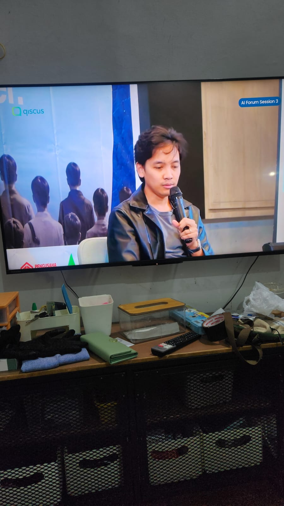
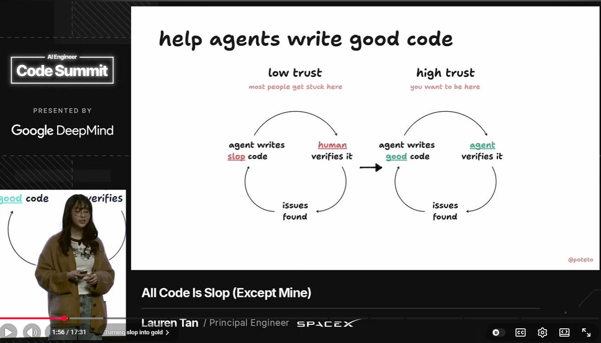
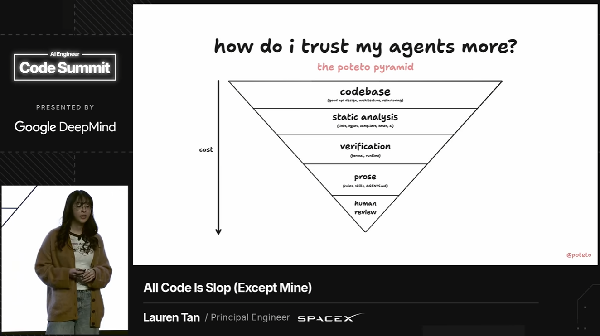

> I think I need to state this earlier
> I'm not targeting the individual or some group, this is purely opinion based on what happen on internet
> and if my source is false, I still open to have a discussion and admit it if wrong
> so please have a nice discussion 

holla clankers, been a long time ya! 

didn't do much larping this week, I just feel this AI shit could replace my addiction with game, I don't play game for almost 3 month bro. I did more AI this year.

---

ok lest go, my thought is start from this video 

https://www.youtube.com/watch?v=-D1Qv7_kwmo

talk and interview with gogo, the so called 100x engineer, I believe he is the best when we talk about the engineering career climber.

I'm stating a fact

> he is the best when it comes with professional social climber 

now anyway, about the video, its a great video talk with gogo talking about how he, as the 100x engineer utilize the AI

believe it or not, I watch this video several time, until my kids asking me "who that person dad", I simply say "some great dude I adore"

I'm not gonna deep talking about the video, I much more into the perspective or the utilization of AI in indonesia.

Believe it or not, how indonesian utilize the AI is so different from the outside perspective 

also I don't have any proper data, this is just merely collective opinion from a social media.

---

so about gogo video, he surelly telling us about this

> he does have 30 VM, with 30 different account, 17 claude account, and 13 codex account, some connected with DeepSeek API account

with this setup gogo wanna push the AI limit by doing

> "What if my AI setup is go wild!"

what it mean by go wild ?

he design the AI to do some bisnis or product experiment by giving the AI the business metric and expecting to improve it by designing some of the product improvement, such as improve the CTR or the system accuration. 

the result ?

> "Failed Experiment and Expensive"

said gogo, and it cost him 50.000 USD a month

---

now lets compare with lauren tan, she does the "High-Velocity Autonomous Workflows" almost like what might be gogo wanted 

yea almost same la, she engineered the multi-agent orchestration system that capable of shipping 2500+ PR a month 
 
https://youtu.be/O_zcc6Xl12g?si=gH7_r7eCdTswn3Wu&t=116 

I got interested with her point

with the achievement she claim :

1. Customer Support Scaling +175% increase in ticket volume absorbed with 0 new hires (saving ~200 hires), resolving 99% of refunds at $0.20–$0.30 per ticket.  https://x.ai/news/grok-bot-customer-support
2. Incident Backlog Clearance 204 tickets cleared in ~10 minutes during a live product incident using IncidentWatch and IncidentSweep bots. https://x.ai/news/incident-sweep 
3. Procurement Cost Savings $100,000+ saved in week one across ~125 vendors (flagging 43 inactive seats worth $14,220, $85,662 in unused plans, and cutting a $14,629 hardware order to $6,143). https://x.ai/news/grok-bot-procurement 
 
---

now what makes it different ? is it considered skill2win ? or because she work at the big company she still pay2win ?

ok lets find another example maybe Yegge from this video 

https://www.youtube.com/watch?v=I3iRsti-Lmw

his motivation is pretty simple, he own MMORPG Wyvern and that game have so many problem,

he spawn 50 agent, 12 max claude account (2400 usd/month), and 12 mac studio (idk around 25.000 USD), he design the Agent Org Chart, load balancing the worker with fleet, also routing and rotating the 21 max account. solve many issue and create new feature within the game which is super awesome, and he made the Beads (https://github.com/gastownhall/beads, the persistent memory for fleet worker) and also the wheelhouse kinda like multi-agent orchestration 

---

ok now lets define the term, what is pay2win and skill2win anyway 

in my opinion pay2win is much more like 

> you spent more money to gain the advantage 

while skill2win

> you spent more time with skill to get the advantage

now why I bother this ?

I simply have a question in my mind 

> do I need that much money to get the advantage ?

> do I need a lot of money to outrun the people ?

---

https://x.com/naufaldi/status/2121778921079505054 

now this become much more like consumerism, when you feel you consume more, you "feel" having the advantage 

somehow the statement is kinda false, because this "image" of pay2win kinda like illusion for me 

its true you have a bigger ram you will feel fast, but doesn't mean your achievement will be different

because I never have a great device from begining, but I believe I could outrun someone 

and this makes me think pay2win is a gimmick, skill2win is also gimmick.

just do with what you have, learn more

because of that post on X, I'm actually interest with the indonesia "consumerism"

---

my conclusion is pretty simple,

just don't waste your time

everyone have a different pace 

invest your money and time better

don't stop

keep run 

don't look back 

you already did great

